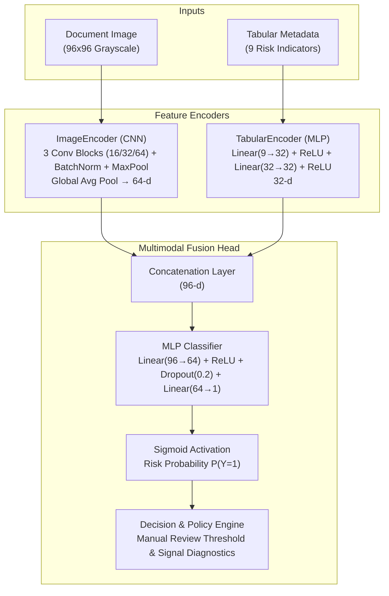
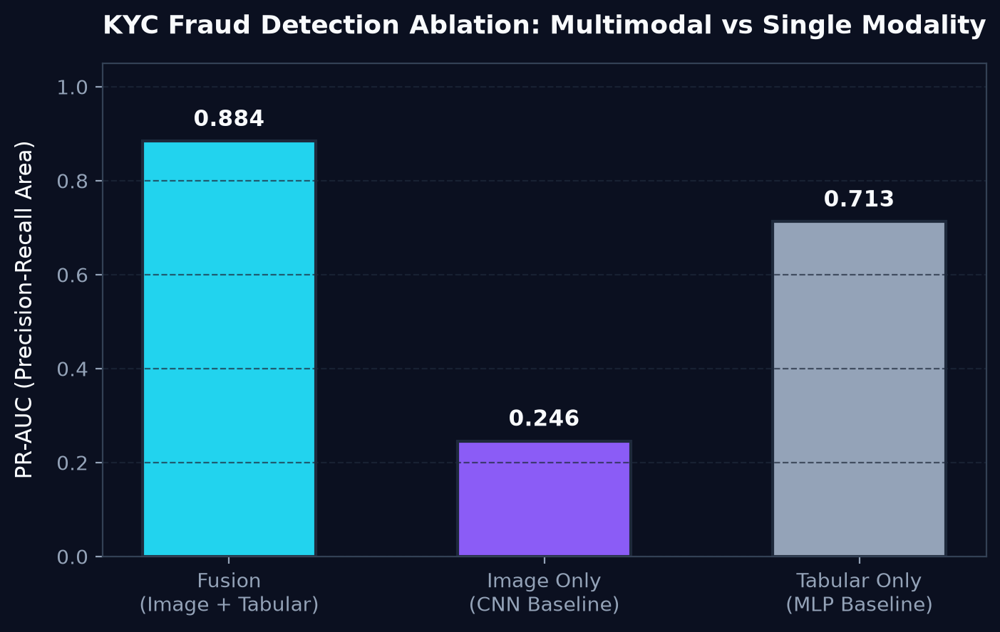
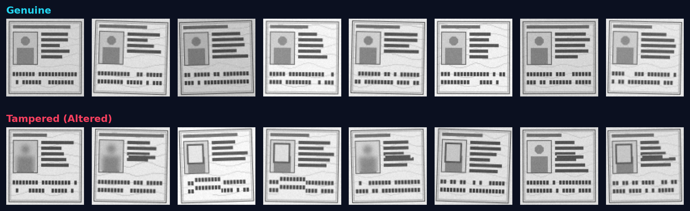

# Multimodal KYC Risk Scoring

[](https://github.com/pulok529/multimodal_kyc_risk/actions/workflows/ci.yml)
[](pyproject.toml)
[](https://pytorch.org)
[](https://fastapi.tiangolo.com)
[](Dockerfile)
[](LICENSE)

An end-to-end, high-throughput multimodal machine learning system for Know Your Customer (KYC) identity fraud detection and applicant risk scoring. The architecture combines a convolutional neural network (CNN) for detecting subtle document image forgeries with a multilayer perceptron (MLP) for scoring tabular applicant metadata, fusing both representations into a calibrated risk score with human-readable decision signals.

---

## Architecture



---

## Results

Held-out test split (15% of 6,000 synthetic applicants, about 10% high-risk). Trained on CPU with `python -m kyc_risk.train --n 6000 --epochs 12`. Each model's threshold is chosen on validation for 90% precision, falling back to best F1.

| Model | PR-AUC | ROC-AUC | Precision | Recall |
|---|---|---|---|---|
| **Fusion (CNN + MLP)** | **0.884** | **0.977** | 0.942 | 0.533 |
| Tabular only (MLP) | 0.713 | 0.914 | 1.000 | 0.391 |
| Image only (CNN) | 0.246 | 0.675 | 1.000 | 0.011 |

**Reading the ablation.**
- **The label needs both inputs:** risk depends on both a tampered document and the applicant's behaviour, so neither input alone is enough.
- **Image only:** a tampered document alone doesn't make an applicant high-risk, so the CNN can only find the tampered share of cases (PR-AUC 0.25 against a 0.10 base rate).
- **Tabular only:** the MLP misses risky applicants whose risk shows up only in the document.
- **Fusion:** it lifts PR-AUC from 0.71 to 0.88 and recovers about 36% more high-risk applicants than the tabular model at a similar precision.

<p align="center">
  
</p>

<p align="center">
  
</p>

---

## Why Multimodal (Ablation)

In high-assurance digital onboarding, fraud signals rarely manifest cleanly within a single channel:

1. **Document-Only Blindspots**: Sophisticated criminal syndicates regularly present authentic, unaltered physical identity documents paired with compromised credentials, high device velocity, or mismatched jurisdictional IP locations (synthetic identity fraud and account takeover). A computer vision system operating without tabular telemetry assesses these documents as genuine.
2. **Tabular-Only Blindspots**: Conversely, applicants submitting forged, digitally altered, or copy-moved documents often provide internally consistent tabular metadata (e.g., standard age, clean credit address records, or spoofed low-risk device signatures). A tabular scoring model cannot detect localized document alterations.
3. **Multimodal Late Fusion Advantage**: Fusing both representations enables the classifier to condition decisions on the presence of compounding cross-modal risk factors. As demonstrated in the ablation benchmark, joint late fusion achieves superior Precision-Recall AUC compared to either modality evaluated in isolation.

---

## Synthetic Data Design & Tampering Types

To ensure fully reproducible evaluation without handling sensitive PII, the repository implements a deterministic procedural data generator creating ID-card-like vector and raster layouts:

* **Card Geography**: Outer protective border, guilloche sine-wave background pattern, card header bar, photo portrait silhouette, 4 to 6 text-like demographic bars, and a dual-row Machine Readable Zone (MRZ) block stripe.
* **Realistic Sensor Degradation**: All cards (genuine and altered) receive sensor Gaussian noise, random subtle rotations ($\pm 3^\circ$), and randomized brightness and contrast scaling.
* **Procedural Tampering Artefacts**:
  * `pasted_rectangle`: Incongruous texture and luminance bounding box pasted over the photo box.
  * `misaligned_mrz`: Segment-level vertical and horizontal displacement of machine-readable characters.
  * `blurred_region`: Localized Gaussian filtering masking credential details.
  * `copy_moved_text`: Duplication and spatial translation of text bar blocks across fields.
* **Tabular Feature Set**:
  * `age`: Applicant age (18–75).
  * `account_age_days`: Account history tenure in days.
  * `country_risk`: Regulatory and jurisdictional risk factor ($0.0–1.0$).
  * `device_risk`: Device fingerprint / proxy / emulator risk index ($0.0–1.0$).
  * `num_failed_logins_30d`: Pre-submission authentication failures ($0–10$).
  * `selfie_match_score`: Biometric facial comparison confidence ($0.0–1.0$).
  * `address_mismatch`: Binary flag indicating document address vs credit bureau address discrepancy.
  * `pep_flag`: Binary flag indicating Politically Exposed Person status.
  * `velocity_signups_same_device`: Cumulative onboarding attempts detected from the hardware signature.

---

## Training Setup

* **Dataset Scale & Partitioning**: 6,000 synthetic applicants partitioned into stratified 70% train (4,200), 15% validation (900), and 15% test (900) splits.
* **Optimization**: AdamW optimizer ($\text{lr} = 10^{-3}$, weight decay $10^{-4}$) minimizing `BCEWithLogitsLoss`.
* **Imbalance Handling**: Class weighting via dynamic `pos_weight = N_neg / N_pos` derived strictly from the training partition.
* **Regularization & Early Stopping**: Dropout ($p=0.2$) on fusion heads, with validation PR-AUC early stopping (patience of 3 epochs).
* **Hardware & Throughput**: Configured for rapid execution on standard commodity laptop CPUs in under 3 minutes (`torch.set_num_threads` auto-capped at 4, `num_workers=0`). CUDA is activated automatically when available.

---

## Quick Start

### Local Environment

```bash
# 1. Clone repository
git clone https://github.com/pulok529/multimodal_kyc_risk.git
cd multimodal_kyc_risk

# 2. Create and activate virtual environment
python -m venv .venv
source .venv/bin/activate  # On Windows: .venv\Scripts\activate

# 3. Install CPU-optimized dependencies
pip install --no-cache-dir torch --index-url https://download.pytorch.org/whl/cpu
pip install -r requirements-dev.txt

# 4. Train models and generate artifacts (< 1 minute on CPU)
python -m kyc_risk.train --n 6000 --epochs 8 --out artifacts/

# 5. Launch FastAPI service
uvicorn api.main:app --host 0.0.0.0 --port 8000
```

### Docker Deployment

```bash
# Build production Docker image (pre-trains artifacts during build)
docker build -t kyc-risk:latest .

# Run containerized API service
docker run -d --name kyc-app -p 8000:8000 kyc-risk:latest

# Verify health status
curl -s http://localhost:8000/health
```

---

## API Examples

### Health Check

```bash
curl -X GET http://localhost:8000/health
```

```json
{
  "status": "ok",
  "model_loaded": true,
  "version": "1.0.0"
}
```

### Download Synthetic Sample Document

```bash
# Download a synthetic tampered document for testing
curl -s http://localhost:8000/sample/tampered -o sample_doc.png
```

### Score Applicant (Multipart Request)

```bash
curl -X POST http://localhost:8000/score \
  -F "file=@sample_doc.png" \
  -F 'applicant={
    "age": 31,
    "account_age_days": 12,
    "country_risk": 0.78,
    "device_risk": 0.85,
    "num_failed_logins_30d": 3,
    "selfie_match_score": 0.48,
    "address_mismatch": 1,
    "pep_flag": 0,
    "velocity_signups_same_device": 4
  }'
```

#### Example Output Response

*(Example representation)*

```json
{
  "risk_probability": 0.8421,
  "decision": "manual_review",
  "threshold": 0.4852,
  "signals": [
    "Low selfie match score (< 0.60)",
    "High device risk score (> 0.70)",
    "Applicant address mismatch detected",
    "Repeated failed logins in last 30 days (>= 3)",
    "Elevated signup velocity on device (> 3 accounts)",
    "High country risk score (> 0.70)"
  ]
}
```

---

## Project Structure

```text
multimodal_kyc_risk/
├── .github/
│   └── workflows/
│       └── ci.yml                 # Python 3.12 CI test and Docker integration pipeline
├── api/
│   ├── __init__.py
│   └── main.py                    # FastAPI application, Pydantic schemas, endpoints
├── docs/
│   ├── ablation.png               # Multimodal vs single-modality comparison chart
│   └── samples.png                # Grid of synthetic genuine vs tampered documents
├── notebooks/
│   └── 01_multimodal_kyc_walkthrough.ipynb  # Interactive walkthrough notebook
├── src/
│   └── kyc_risk/
│       ├── __init__.py            # Package metadata (__version__ = "1.0.0")
│       ├── dataset.py             # PyTorch Dataset and standard scaler utilities
│       ├── models.py              # CNN ImageEncoder, MLP TabularEncoder, FusionModel
│       ├── predict.py             # Inference pipeline and human-readable signals
│       ├── synth.py               # Procedural ID card generator and dataset synthesizer
│       └── train.py               # Stratified training pipeline, early stopping, CLI
├── tests/
│   ├── __init__.py
│   ├── test_api.py                # FastAPI endpoint tests
│   ├── test_models.py             # Model forward shape tests
│   ├── test_synth.py              # Synthetic generation and label distribution tests
│   └── test_train.py              # End-to-end training and artifact verification
├── .dockerignore
├── .gitignore
├── Dockerfile                     # Multi-stage CPU-optimized container specification
├── LICENSE                        # MIT License
├── Makefile                       # Developer automation commands
├── pyproject.toml                 # Package configuration, Ruff, Pytest settings
├── README.md                      # Project documentation and benchmarks
├── requirements.txt               # Application dependencies
└── requirements-dev.txt           # Testing and linting dependencies
```

---

## Limitations & Responsible Use

* **Synthetic Data Only**: This project utilizes entirely synthetic, procedurally drawn representations and synthetic applicant vectors. It contains no real customer personal data, biometric images, or actual government-issued credentials.
* **Regulatory Compliance**: Production KYC and anti-money laundering (AML) operations must adhere strictly to jurisdiction-specific frameworks including GDPR, CCPA, BSA/AML, and local financial intelligence unit requirements.
* **Informed Consent & Privacy**: Real-world biometric matching and document ingestion require transparent applicant consent, encrypted document transit and storage, and data minimization protocols.
* **Disparate Impact & Bias Audits**: Automated decision-making systems must undergo recurring demographic parity and disparate impact audits across age, nationality, and biometric sub-populations.
* **Human-in-the-Loop Review**: High-risk model classifications should route to accredited compliance officers for manual verification rather than triggering unconditional automated denial.

---

## Roadmap

* [ ] **Pretrained Vision Backbones**: Integrate lightweight mobile backbones (e.g., MobileNetV4, EfficientNet-Lite) fine-tuned on document forgery benchmarks.
* [ ] **Automated Document OCR & Field Consistency**: Extract MRZ and visual inspection zone (VIZ) text with OCR to perform automated cross-field parity checks.
* [ ] **Facial Liveness & Spoof Detection**: Incorporate anti-spoofing and presentation attack detection (PAD) on biometric selfie uploads.
* [ ] **Explainability & Attribution Maps**: Implement Grad-CAM visualization for localized forgery heatmaps on flagged document coordinates.
